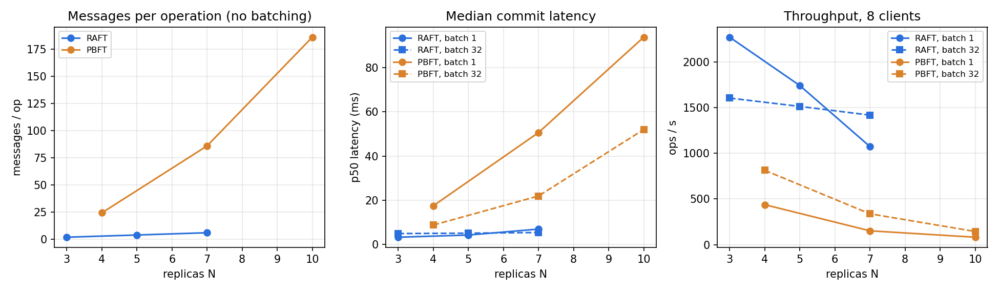

# Multi-user Whiteboard with Distributed Consensus

A shared whiteboard whose edits are ordered by a replicated server cluster running
either **Raft** (crash fault tolerant) or **PBFT** (Byzantine fault tolerant, with view
change, checkpoints and state transfer). Clients sign their requests, committed edits form
a hash-chained ledger of Merkle-rooted blocks, and a live fault injector can crash,
silence, partition or turn a replica Byzantine while a checker verifies the safety
properties after each run.

CS23B030, Ujwala.

## What it shows

| Scenario | Raft | PBFT |
| --- | --- | --- |
| 2 of 5 replicas crash | keeps committing; a 3rd crash stalls it | 1 of 4 crashed: keeps committing |
| primary/leader crashes | new leader in ~0.7 s | view change to a new primary in ~0.8 s |
| S1: leader/primary equivocates | honest replicas commit different ops and altered requests: **safety and validity violated**, ledger forks | **safe**: the altered request fails its client's signature, signed proof against the primary triggers a view change, and work resumes |
| S2: a backup lies | n/a | outvoted, keeps committing |
| S3: one voter votes for everyone across a partition | **two leaders**, diverging commits | n/a |
| a replica lies to its own clients | its clients see the lie | clients draw only blocks f+1 replicas agree on, and flag the liar |
| a replica is killed (SIGKILL) and restarted | rejoins from its fsynced term, vote and log | a lagging replica catches up by state transfer |

## Key results

From `scripts/eval.sh` on one laptop (details and plots in `results/`):

- **Message cost (E1):** Raft sends n-1 messages per operation; PBFT sends (n-1) + (n-1)² + n(n-1), measured as 24.4, 86 and 186 for 4, 7 and 10 replicas (predicted 24, 84, 180; checkpoints add the rest). Batching up to 32 strokes cuts PBFT's cost 2.3–3.8×.
- **Latency (E1):** PBFT's median commit latency rose from 17.5 ms at 4 replicas to 94 ms at 10; Raft stayed under 7 ms up to 7.
- **Interactivity (E2):** a stroke stays under 100 ms up to about 46 ms of one-way network delay with Raft and about 30 ms with PBFT (≈2 and ≈3 one-way delays per stroke).
- **Failover (E3, median of 5):** a crashed Raft leader froze the board for 692 ms; a crashed PBFT primary for 768 ms (view change); a crashed PBFT backup made no difference.
- **Signatures (E6, E7):** Ed25519 costs 21 µs to sign and 47 µs to verify per message, against 1 µs for HMAC; on the running cluster that is +23% median latency at 4 replicas and +27% at 7.
- **Durability (E8):** fsyncing Raft's term, vote and log before every reply raises median latency from 5.1 to 13.1 ms.




## Layout

| Path | What it is |
| --- | --- |
| `cmd/replica` | one replica: gRPC to peers on 7000+i (or `-addrs`), HTTP/WebSocket on 8000+i |
| `cmd/checker` | verifies agreement, hash chains, Election Safety, validity (client signatures), no duplicates, real-time order, log matching, and equivocation proofs |
| `cmd/bench` | closed-loop load generator: latency, throughput, messages per op, longest freeze |
| `cmd/keygen` | Ed25519 key pair per replica (and the shared key for `-auth hmac`) |
| `cmd/sign` | signs a request as a client, for scripts |
| `internal/raft` | Raft, with `-data` persistence (`store.go`) and Byzantine hooks |
| `internal/pbft` | PBFT: three-phase commit, view change, checkpoints, state transfer, retransmission |
| `internal/server` | ledger, Merkle trees, batching, deduplication, request watching, WebSocket push |
| `internal/fault` | crash, omit, partition, equivocate, delay |
| `internal/common` | replica signatures (or HMAC), client request signatures, evidence, gRPC interceptors |
| `web/` | SVG client; `board.js` holds the f+1 quorum and last-writer-wins logic |
| `scripts/` | demos (`demo_*.sh`), `eval.sh`, `plot.py`, Docker scripts |
| `results/` | evaluation output |

## Running

Needs Go 1.25 and, for the client tests and demo, Node 18. From WSL/Linux:

```bash
go test ./internal/... -race        # Go tests (31)
node --test web/                    # client logic tests (7)
./scripts/demo_s1.sh raft           # Scenario S1, Raft: safety violation
./scripts/demo_s1.sh pbft           # Scenario S1, PBFT: safe, view change, with proof
./scripts/demo_s3.sh                # Scenario S3: two Raft leaders
./scripts/demo_client.sh            # a replica lying to its clients
./scripts/demo_raft_crash.sh        # Raft crash boundary
./scripts/demo_restart.sh           # Raft: SIGKILL and restart with persisted state
./scripts/demo_pbft_restart.sh      # PBFT: SIGKILL, restart empty, catch up by state transfer
./scripts/eval.sh                   # experiments E1-E8 -> results/
```

To draw: `./scripts/run_cluster.sh pbft 4`, then open `http://localhost:8000` and
`http://localhost:8001` in two windows. Faults are switched at run time, for example
`curl -X POST 'localhost:8001/admin/fault?mode=equivocate'`. Set `PBFTDEBUG=1` to trace
view changes.

One replica per container (real network delay with `tc netem`, real crashes with
`docker kill`): `scripts/docker_cluster.sh pbft 4`, `scripts/docker_delay.sh 25ms`,
`scripts/docker_eval.sh`. Docker Desktop must be running; set `DOCKER` to `docker.exe`'s
path if its WSL integration is off. These scripts have not been run yet.

## Limitations

- Every replica runs on one laptop, so latency at larger N includes CPU contention.
- Only Raft persists its state; a PBFT replica that restarts rejoins by state transfer
  from its peers rather than from disk.
- The real-time order check covers each client's own requests; there is no full
  linearizability checker such as Porcupine.
