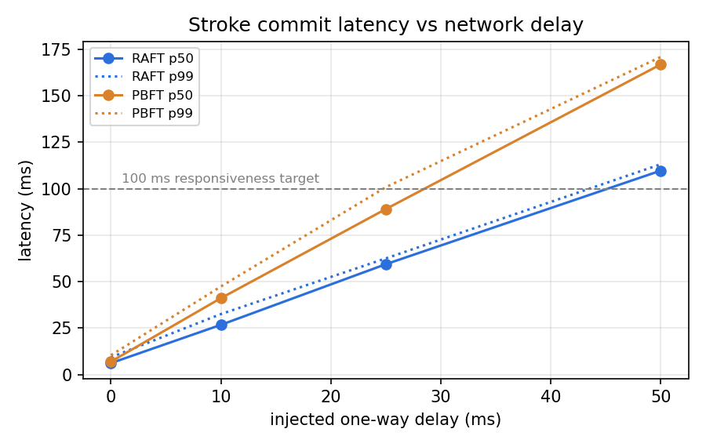

# Multi-user Whiteboard with Distributed Consensus

A shared whiteboard whose edits are ordered by a replicated server cluster running
either **Raft** (crash fault tolerant) or a simplified **PBFT** (Byzantine fault
tolerant, fixed primary). Committed edits form a hash-chained ledger of Merkle-rooted
blocks. A live fault injector can crash, silence, partition or turn a replica
Byzantine, and a checker verifies the safety properties after each run.

CS23B030, Ujwala.

## What it shows

| Scenario | Raft | PBFT |
| --- | --- | --- |
| 2 of 5 replicas crash | keeps committing; a 3rd crash stalls it | 1 of 4 crashed: keeps committing |
| S1: leader/primary equivocates | honest replicas commit different ops: **safety violated**, ledger forks | **safe**: nothing conflicting commits; stalls (no view change); every replica holds signed proof against the primary |
| S2: a backup lies | n/a | outvoted, keeps committing |
| S3: one voter votes for everyone across a partition | **two leaders**, diverging commits | n/a |
| a replica lies to its own clients | its clients see the lie | clients draw only blocks f+1 replicas agree on, and flag the liar |

## Key results

From `scripts/eval.sh` on one laptop (details and plots in `results/`):

- **Message cost:** Raft sends n-1 messages per operation; PBFT sends (n-1) + (n-1)² + n(n-1), measured as 24, 85 and 184 for 4, 7 and 10 replicas (predicted 24, 84, 180).
- **Latency:** PBFT's median commit latency rose from 18 ms at 4 replicas to 180 ms at 10; Raft stayed under 9 ms up to 7.
- **Interactivity:** a stroke stays under 100 ms up to about 45 ms of one-way network delay with Raft and about 29 ms with PBFT.
- **Failover:** a crashed Raft leader froze the board for 725 ms; a crashed PBFT primary froze it for good (no view change).
- **Signatures:** Ed25519 costs 33 µs to sign and 70 µs to verify per message, against 2.1 µs for HMAC.




## Layout

| Path | What it is |
| --- | --- |
| `cmd/replica` | one replica: gRPC to peers on 7000+i, HTTP/WebSocket on 8000+i |
| `cmd/checker` | verifies ledgers, agreement, Election Safety, and equivocation proofs |
| `cmd/bench` | closed-loop load generator: latency, throughput, messages per op |
| `cmd/keygen` | Ed25519 key pair per replica |
| `internal/raft`, `internal/pbft` | the two protocols, with Byzantine hooks |
| `internal/server` | ledger, Merkle trees, batching, deduplication, WebSocket push |
| `internal/fault` | crash, omit, partition, equivocate, delay |
| `internal/common` | signatures, evidence, gRPC interceptors |
| `web/` | SVG client; `board.js` holds the f+1 quorum and last-writer-wins logic |
| `scripts/` | demos (`demo_*.sh`), `eval.sh`, `plot.py` |
| `results/` | evaluation output |

## Running

Needs Go 1.25 and, for the client tests and demo, Node 18. From WSL/Linux:

```bash
go test ./internal/... -race        # Go tests
node --test web/                    # client logic tests
./scripts/demo_s1.sh raft           # Scenario S1, Raft: safety violation
./scripts/demo_s1.sh pbft           # Scenario S1, PBFT: safe, with proof
./scripts/demo_s3.sh                # Scenario S3: two Raft leaders
./scripts/demo_client.sh            # a replica lying to its clients
./scripts/demo_raft_crash.sh        # Raft crash boundary
./scripts/eval.sh                   # experiments E1-E6 -> results/
```

To draw: `./scripts/run_cluster.sh pbft 4`, then open `http://localhost:8000` and
`http://localhost:8001` in two windows. Faults are switched at run time, for example
`curl -X POST 'localhost:8001/admin/fault?mode=equivocate'`.
